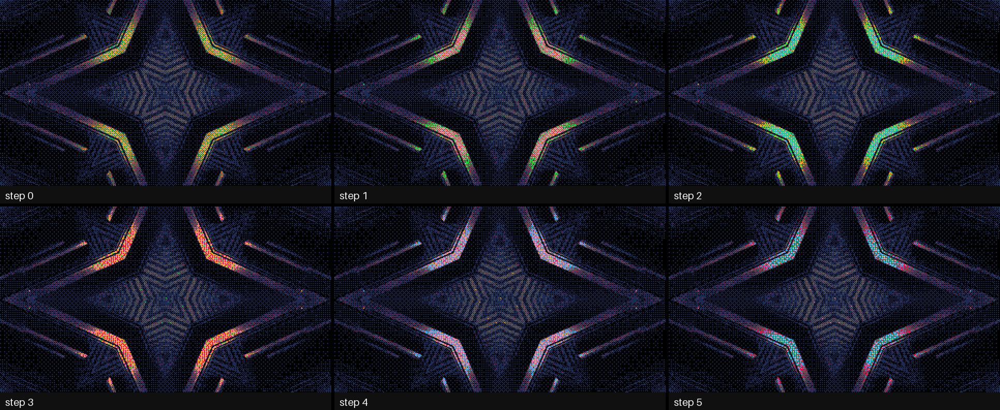
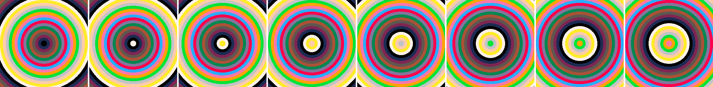

# ramdac

> **AI-assisted project.** This codebase was created with [Claude](https://claude.com/claude-code)
> (Anthropic), directed and reviewed by a human author. Its behaviour is measured rather
> than asserted. An offline harness drives the plugin's own class in a headless GL context
> and checks each claim against a model of its own:
>
> - Every pixel is an entry of the colour table.
> - With no dither, each cell's index is the OKLab-nearest entry, 0 wrong out of 918 827.
> - A palette swap keeps every one of 921 600 indices.
> - Colour cycling rotates the table while the picture's indices stay still.
> - Every dither holds still on a still clip, bit for bit.
>
> 11 negative controls and 35 one-character mutants prove the checks can fail. On Windows
> the release build has run in Resolume Arena, on software rendering, through the fleet's
> Arena gate. It has **never been loaded into Resolume on macOS**. The full rundown is
> under [Status](#status).

Indexed colour, as an FFGL effect for [Resolume](https://resolume.com) Arena and Avenue.
It forces a clip into the 4, 8 or 16 colours of a real machine (C64, CGA, Spectrum, CPC,
NES, Game Boy, PICO-8, teletext, the Amiga's Workbench), a palette you type, or one chosen
from the clip. Then it does what indexed displays could do and nothing else could: swap the
palette, fade it, and cycle it the way Deluxe Paint did.


<sub>Rendered by `rmtest`, the offline harness, not captured from Resolume. Resolume's
bundled `IntoTheGlow_02`, 1.67 s in at 640×360 and Pixel Size 2. The Adaptive panel is at
Adapt 0: the clip strobes, and at the default 0.3 s the palette is still following the
flash.</sub>

<!-- downloads:start -->
<!-- downloads:end -->

## The one idea

**The picture becomes an index buffer and a colour table.**

That's how indexed displays worked. Every pixel held a number, and a chip, the RAMDAC,
turned the number into a colour by looking it up in a small table. Swapping the palette,
fading to black and colour cycling were never done to the picture. They were a few bytes
written to the table, and the whole screen changed because it was only ever numbers.

The plugin does the same:

1. The clip is averaged into cells (Pixel Size).
2. Each cell is quantised once, to the index of the nearest palette entry in
   [OKLab](https://bottosson.github.io/posts/oklab/), with or without a dither.
3. What you see is the table looked up by that index.

The table is 16 entries the CPU rebuilds every frame. What falls out of keeping the index
and the colour apart:

- **Every pixel is a palette member**, because the display pass can only look colours up.
- **A swap recolours without re-quantising.** Change the table and the picture's structure
  stays exactly where it was: its contours, its dither pattern, its edges. A C64 picture
  swapped to PICO-8 is not the clip quantised to PICO-8. It has the same shapes in other
  colours.
- **A fade happens in the table**, per index, in OKLab. Every pixel with index i shows the
  same colour at every moment of the fade, so the picture never has more than 16 colours.
- **Colour cycling moves things that don't move.** Rotate a range of the table and a
  gradient's bands march, water runs and fire flickers, while every index stays still.
  That's Mark Ferrari's technique in Deluxe Paint, done the way the hardware did it.
- **Freeze** keeps the indices and lets the table carry on: a held frame whose colours
  still cycle and swap.
- **The DAC is a limit too.** At 12 bits (the Amiga's 4,096 colours) a fade steps through
  sixteen levels a gun, and a palette pushed through it collapses to what the machine
  could show.


<sub>A swap keeps the indices. Top right is the top-left picture with PICO-8's table, and
bottom left is what quantising to PICO-8 afresh would have given.</sub>



<sub>Freeze from the first frame, and cycling Forward over entries 4–11 at 15 steps a
second. Not one index changes between these frames.</sub>

## Dithers

All of them are pure functions of a cell's position. None depends on time, so a still
clip gives a still picture, with no crawl.

- **None.** Nearest in OKLab.
- **Bayer 2, 4 and 8.** Thomas Knoll's pattern dither for an arbitrary palette: N = 4, 16
  or 64 candidates a cell, each the nearest entry to the target plus the error so far
  (kept in linear light, so the pattern's mean is the target's light). The candidates
  are sorted by lightness, and the one at the cell's Bayer rank is shown.
- **Blue Noise.** The same with 64 candidates, ranked by a 64×64 void-and-cluster mask
  (Ulichney) generated in the repo.
- **Dot Diffusion.** Knuth's error diffusion done in parallel: an 8×8 class matrix, each
  pixel decided after its lower-class neighbours and passing what's left of its error to
  its higher-class ones, in linear light. This is the GPU's honest version of error
  diffusion; Floyd–Steinberg is serial both ways. It leaves a faint 8×8 texture where
  Floyd–Steinberg leaves worms.

Dither Amount scales the error, and Pixel Size (1–16) is the cell.

## Palettes

| Palette | Colours | Source |
| --- | --- | --- |
| Adaptive | 2–16 | Chosen from the clip: median cut, then k-means warm-started from the last frame, followed by a one-pole of Adapt seconds. |
| Custom | 2–16 | Typed: `#RRGGBB`, `RRGGBB`, `0xRRGGBB`, `$RGB` or `#RGB`, separated by spaces, commas or semicolons. |
| Teletext | 8 | The RGB cube's corners in teletext's colour-code order (the teletext plugin's own). |
| CGA Mode 4 | 4 | Palette 1 with intensity: black, light cyan, light magenta, white. |
| CGA 16 | 16 | RGBI with brown, as the IBM 5153 showed it. EGA's default palette is the same. |
| Commodore 64 | 16 | Pepto's 2001 measurement of the VIC-II. |
| ZX Spectrum | 15 | Basic at 0xD7 and bright at 0xFF (nesolume's). |
| Amstrad CPC | 14 | Mode 0's steady inks at power-on (the firmware manual), at MAME's three levels. |
| NES | 16 | The 2C02's four greys and alternate hues of rows 1 and 2 (nesolume's table). |
| Game Boy | 4 | The DMG's four greens (nesolume's). |
| PICO-8 | 16 | PICO-8's sixteen. |
| Workbench 1.3 | 4 | $05A $FFF $002 $F80. |
| Workbench 2.0 | 4 | $AAA $000 $FFF $68B. |

[ATTRIBUTIONS.md](ATTRIBUTIONS.md) gives each palette's source, and `rmtest --palettes`
checks every table against the harness's own transcription. Order sets what "index" means
to a swap and a cycle range: Lightness (OKLab L, darkest first) or the machine's Native
order. DAC puts every colour through 24, 18 (VGA), 12 (Amiga) or 9 bits a pixel.

## Swap and cycle

**Swap** fades from the palette to Swap To as it goes from 0 to 1:

- **Cut** changes the whole table at ½.
- **Fade** moves each index along the straight line in OKLab.
- **Ripple** cuts one index at a time, darkest first in Lightness order.

Index i of an N-entry palette meets entry ⌊(i + ½)·M/N⌋ of an M-entry one.

**Cycle** is Deluxe Paint's colour cycling (IFF's `CRNG`). It rotates the range Cycle
Start … + Cycle Length:

- **Direction:** Forward (each colour one register up a step, CRNG's "upwards"), Reverse,
  or Ping-Pong (which isn't CRNG's).
- **Rate:** Cycle Rate, 0–60 steps a second (CRNG's whole range), or a step a beat or a bar.
- **Blend:** Step (DPaint's) or Smooth (an OKLab blend between steps, through the DAC).

The phase is kept in double on the CPU, so Resolume's very large clock never reaches the GPU.



## Controls

| Group | |
| --- | --- |
| **Palette** | Palette (the table above), Colours (Adaptive's, 2–16), Adapt (how fast Adaptive follows the clip, 0–4 s), Custom (text), Order (Lightness, Native), DAC (24-bit, 18-bit, 12-bit, 9-bit). |
| **Dither** | Dither (None, Bayer 2, Bayer 4, Bayer 8, Blue Noise, Dot Diffusion), Dither Amount, Pixel Size (1–16). |
| **Swap** | Swap To, Swap (0–1), Swap Style (Cut, Fade, Ripple). |
| **Cycle** | Cycle (Off, Forward, Reverse, Ping-Pong), Cycle Rate (0–60 steps a second), Cycle Sync (Free, Beat, Bar), Cycle Start, Cycle Length, Cycle Blend (Step, Smooth). |
| **Output** | Freeze, Alpha (Keep: the clip's coverage; Opaque), Mix. |

The defaults are PICO-8 through Bayer 4 at Pixel Size 2, with the swap waiting on the
Commodore 64 with a Fade, and cycling off. When cycling is on it runs at eight steps a
second over the whole table.

## Status

**v0.1.0**, the first release. Measured offline on one Mac, and run in Resolume Arena on
Windows. There's a [user guide](https://stoatworks-labs.com/software/ramdac/guide/).

### Measured offline, on macOS

`tools/verify.sh` passes on this machine (Apple Silicon, macOS 26) against a fresh
universal Release build. It runs every picture check at **two rasters**, 1280×720 and
320×180, and again on **Apple's software renderer** at 320×180, where all 15 picture
checks pass too (158 judgements). The whole run takes about eight minutes. Numbers below
are at 1280×720:

| check | result |
| --- | --- |
| `--members` | every pixel exactly one of the table's 8-bit entries, across all 11 fixed palettes, every dither on PICO-8, Adaptive and Custom, mid-cycle, after a Cut and mid-Fade: **0** pixels not in the table |
| `--nearest` | with no dither, each cell's index against the OKLab-nearest entry, computed by the harness's own route (sRGB → XYZ → Ottosson's M1, M2) in double: **0 of 918 827** wrong on PICO-8 at Pixel Size 1; 2 773 (0.3%) are near-ties whose decision the input's rounding could flip, and these are counted, not judged; the same on CGA 16 and the C64 and at Pixel Size 3 |
| `--tone` | Bayer 2 and 4 on black and white over flat greys: a cell is white exactly when its rank passes N − ⌈Nv − ⅛⌉, **0 of 921 600** wrong; Bayer 8 and Blue Noise 0 of 887 040 (3.8% at the midpoint not judged); on PICO-8 and CGA 16 every cell is the harness's own Knoll candidate at its rank: 0 wrong |
| `--diffusion` | every cell is the nearest entry to its colour plus its lower-class neighbours' shares, and stores the remainder (read back from the GPU): **0** indices and 0 errors off Knuth's recurrence, on three greys and two palettes; the class matrix is the paper's |
| `--still` | six dithers × PICO-8, Custom and Adaptive on a still clip: **0** values differ three frames apart |
| `--swap` | C64 → PICO-8, PICO-8 → Game Boy, CGA 16 → Teletext: a Cut leaves **0 of 921 600** pixels anything but B's entry for their index; mid-Fade, 0 indices show two colours and 0 are off the OKLab line by more than a code; Ripple at nine points, 0 pixels out of index order |
| `--cycle` | Forward, Reverse and Ping-Pong at 15 steps a second: every frame is the still picture with its table rotated, measured from the pictures, **0 of 100** frames wrong; a period on, bit for bit the same; a step a beat and a bar at 120 bpm, 0 of 87 wrong (13 on a beat's edge not judged); Smooth's whole steps equal Step's |
| `--clock` | a host clock 499 217 238 ms into its session renders the same take as one starting at 0: **0 codes** apart, Step and Smooth |
| `--adaptive` | after a cut to a still the target settles at once and the picture holds from frame 47 (the one-pole's bound at 0.3 s: 48); under two codes of noise on every pixel every frame no entry moves more than **0.0014** in OKLab a frame (bound 0.002, a tenth of a just-noticeable difference; 0.0016 at 320×180); k-means never ends worse than its median cut (0 of 440 frames); white slats a pixel wide over navy stay white |
| `--dac` | at 12, 18 and 9 bits, plain, mid-fade, mid-cycle and Adaptive: **0** channels off the DAC's grid; PICO-8's sixteen land on each grid's nearest level |
| `--freeze`, `--resize` | 40 frozen frames of a moving clip while the table cycles: 0 indices changed; a resize or a new Pixel Size under Freeze: **0** cells not the old index under their centre |
| `--alpha`, `--mix`, `--state` | a premultiplied cell at coverage ½ shows its entry × ½ (Keep) or the entry (Opaque), 0 wrong; Mix 0 is the clip bit for bit; the host's GL state comes back for every dither, across resizes and Freeze |
| offline | the eleven tables against their sources, 0 differ; the Custom parser; Ottosson's published OKLab table reproduced to 4.0e-4 (three printed decimals), and the plugin's matrices within 8.7e-5 of that route; the blue-noise mask a permutation of 0–4095 with 0.0003 of white noise's low-frequency power; every name within 16 bytes |
| `--negative` | **11** deliberately wrong models, **11** caught |
| mutation | **35** one-character mutants of the shipped GLSL and C++, **35** caught |
| `tools/sweep.py` | all **21** controls measurably change the picture |
| `tools/siblings.py` | teletext's eight, copperlist's ×17, and nesolume's Game Boy, NES and Spectrum: the same values |
| shaders | all 9 compile through `glslc`, not only through Apple's driver |
| the bundle | universal (`x86_64 arm64`), exports `plugMain`, ad-hoc signs; `oxbow` reports `SW Ramdac` / `RM01` / `effect` with 26 parameters and renders 120 frames through `plugMain` |

Each tolerance is worked out from what can legitimately move a value:

- **Half floats:** Apple's GPU truncates when it writes them, so a half-float bound is one
  ulp, not half of one.
- **Float sums:** the error of the GPU's float sums.
- **Near-ties:** decisions whose margin is smaller than the input's own rounding could move
  it are counted and left unjudged, never guessed.

### In Resolume Arena, on Windows

The fleet's Arena gate (`arena/` in plugin-bench) ran the release workflow's own Windows build
in **Resolume Arena 7.27.1** on win-lab, a Windows VM with no GPU (Mesa's llvmpipe), twice. Both
times the DLL loads and registers as `SW Ramdac`, `RM01`, an effect; all 27 controls (Arena's
Opacity and the plugin's 26) arrive with the names, order, types, ranges and defaults declared;
it renders; and Arena's log stays clean: **9 passed, 0 failed, 1 skipped**.

Against Arena's still test picture, 15 of the plugin's controls measurably changed the frame.
Palette, DAC, Dither, Dither Amount, Pixel Size, Swap, Cycle and Mix did at the defaults;
Colours, Order, Swap To, Swap Style, Cycle Start, Cycle Length and Cycle Blend did once Adaptive,
a swap or a cycle gave them something to act on. Adapt, Cycle Rate and Cycle Sync only set a
pace, Freeze holds what a still already holds, and Alpha acts only on a clip with coverage below
1, so a still, opaque picture can't measure those five; Custom, a text control, wasn't probed.
Software rendering says nothing about a GPU, or about speed.

### Cost

GPU time by `GL_TIME_ELAPSED`, median of 60 frames after a warm-up, at Pixel Size 2. The
GPU is shared with other work, so the small numbers wobble from run to run.

| | 720p | 1080p | 4K |
| --- | --- | --- | --- |
| None | 0.26 | 0.42 | 1.52 |
| Bayer 4 | 0.95 | 1.32 | 2.37 |
| Bayer 8 | 1.34 | 1.60 | 5.41 |
| Blue Noise | 0.72 | 1.42 | 5.35 |
| Dot Diffusion | 3.34 | 3.65 | 4.19 |
| Adaptive 16, Bayer 4 | 2.98 | 3.12 | 6.09 |

In milliseconds, from `verify.sh`'s own run. An earlier run on a quieter GPU measured
None at 0.09 ms and Bayer 4 at 0.25 ms at 720p, and Dot Diffusion at 2.41. The 4K figures
agree to within a fifth. Dot Diffusion's 128 small draws make it cost about the same at
every size. Adaptive adds a synchronous read-back and k-means on the CPU, about 0.3 ms
more wall time. macOS figures only.

### Not established

- **It's never been loaded into Resolume on macOS.** On a Mac it has only been measured
  offline against the plugin's own class in a headless CGL context, plus an `oxbow` load.
  On Windows, Arena has only run it on software rendering, on a still picture.
- **Nobody has seen yet:**
  - how Cycle Sync follows Arena's transport;
  - what a GPU other than this Mac's makes of it;
  - what Resolume's own clips do to the frame rate at 4K.
- **Dot Diffusion's tone runs light** on a two-colour palette over flat dark greys. A
  0.03 grey comes out at 0.12 in linear light. The decision is made in OKLab, whose
  black–white midpoint is 0.125 in linear light. So a dark cell that tips white leaves a
  large negative error, and the clamp that keeps the next cell's colour in range throws
  most of it away. On the clip, through PICO-8 or the C64, Dot Diffusion's mean light is
  within 2% of the clip's. Knoll's dithers have no such drift (`--tone` measures them
  exact).
- **Adaptive follows the clip at Adapt seconds** (0.3 by default). A flash shorter than
  that is never fully reached, so set Adapt to 0 for a strobing clip.
- No browser demo or presets.

[AGENTS.md](AGENTS.md) lists what else is assumed.

## Build

macOS (universal: Apple Silicon and Intel):

```bash
git submodule update --init
```

```bash
cmake -B build -DCMAKE_BUILD_TYPE=Release
```

```bash
cmake --build build
```

```bash
cmake --install build
```

The last one copies `Ramdac.bundle` into `~/Documents/Resolume Arena/Extra Effects`.
Restart Arena and it's under Effects as **SW Ramdac**.

Windows needs Visual Studio 2022 and vcpkg (for GLEW). It hasn't been built there yet.

## Building and testing

```bash
tools/verify.sh
```

That's everything:

- a fresh universal build;
- every check at two rasters and on the software renderer;
- the negative controls, the mutants, and the sweep for dead controls;
- the shared-colour check against the sibling plugins;
- the bundle's architecture and plist, and an ad-hoc signature;
- a host's view of the bundle through `oxbow`;
- the render cost.

`CLAUDE.md` lists the checks one by one.

Render a frame of your own:

```bash
./build/rmtest --out /tmp/ramdac.png --set "Palette=Commodore 64" --set "Dither=Blue Noise"
```

Or put a clip through it:

```bash
ffmpeg -i in.mov -vf fps=60 -f rawvideo -pix_fmt rgba - | ./build/rmtest --pipe --size 1920x1080 --set "Palette=Amstrad CPC" | ffmpeg -f rawvideo -pix_fmt rgba -s 1920x1080 -r 60 -i - out.mp4
```

## License

MIT. See [LICENSE](LICENSE) and [ATTRIBUTIONS.md](ATTRIBUTIONS.md).

<!-- attributions:start -->
This project is built on other people's work — see [ATTRIBUTIONS.md](ATTRIBUTIONS.md).
<!-- attributions:end -->
