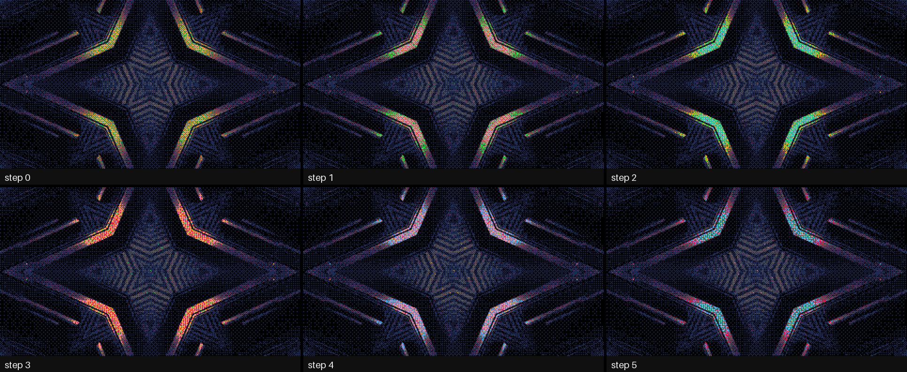

# Ramdac user guide

Ramdac is **indexed colour for [Resolume](https://resolume.com) Arena and Avenue**: one FFGL
effect, **SW Ramdac**, that forces your clip into sixteen colours or fewer, the way an 8-bit
machine's screen would have shown it. Pick a palette the hardware really had (the Commodore 64,
the ZX Spectrum, the NES, the Game Boy, CGA, the Amstrad CPC, PICO-8, teletext, the Amiga's
Workbench), type one of your own, or let it choose one from the clip. Then do what indexed
displays could do and nothing else could: swap the palette, fade it, and cycle it the way Deluxe
Paint did.

It works the way the hardware did. Every pixel of an indexed display held a number, and a chip,
the RAMDAC, turned the number into a colour by looking it up in a small table. The plugin turns
your clip into a grid of those numbers and a table of sixteen colours, and what you see is the
table looked up by the numbers. A palette swap, a fade to another palette and colour cycling are
writes to the table, so the picture's numbers never move.


*Rendered by `rmtest`, the offline harness, rather than captured from Resolume: Resolume's bundled
IntoTheGlow_02, 1.67 s in, at 640×360 and Pixel Size 2. The Adaptive panel is at Adapt 0, because
the clip strobes and at the default 0.3 s the palette would still be following the flash.*

> **Before you rely on this:** it's at **v0.1.0**, the first release, and very early days. Its
> behaviour is measured rather than asserted, by a harness (`rmtest`) that drives the plugin's own
> class in a headless GL context on one Apple Silicon Mac (macOS 26), at 1280×720 and 320×180 and
> again on Apple's software renderer. Every pixel on screen is one of the table's colours. With no
> dither, each cell's colour is the one nearest to it in OKLab, checked against the harness's own
> colour maths: none wrong out of 918 827 (2 773 near-ties, where the input's own rounding could
> tip the choice, are counted rather than judged). A palette swap keeps every one of 921 600
> cells' numbers, colour cycling rotates the table while the numbers stay still, and every dither
> holds still on a still clip, bit for bit. Eleven models that are wrong on purpose and 35
> one-character changes to the shipped code are all caught, and all 21 controls measurably change
> the picture.
> It's **never been loaded into Resolume on macOS**. The one host it has run in on a Mac is the
> fleet's own test host, `oxbow`, for 120 frames, so on a Mac nobody has seen its controls in
> Arena's inspector, watched Cycle Sync follow Arena's transport, or seen what Resolume's own
> clips do to the frame rate at 4K.
> On **Windows** it has been in Resolume. The release build loads, registers as `SW Ramdac`
> (`RM01`, an effect) and renders in Resolume Arena 7.27.1 on software rendering (no GPU), twice,
> with all its controls as declared and Arena's log clean, and 15 of them measurably changed
> Arena's picture of a still. The other six can't show on a still, opaque picture, or weren't
> tried: Adapt, Cycle Rate and Cycle Sync only set a pace, Freeze holds what a still holds anyway,
> Alpha needs a clip you can see through, and Custom is a text box. Nobody has watched it follow
> Arena's transport there either, or run it on a Windows GPU.
> Try it on a spare layer before you put it in a show.
>
> This codebase was created with AI assistance, directed and reviewed by a human author.

---

## Installing

Every download carries one effect, **SW Ramdac** (`Ramdac.bundle` on macOS, `Ramdac.dll` on
Windows). Drop it into Resolume's effects folder and restart Resolume:

```
macOS    ~/Documents/Resolume Arena/Extra Effects/
Windows  %USERPROFILE%\Documents\Resolume Arena\Extra Effects\
```

Avenue uses the same layout under its own folder name. The effect then shows up in the effects
browser as **SW Ramdac**.

The macOS download is a universal build (Apple silicon and Intel), as a `.dmg` or a `.zip`.
It's
**Developer ID-signed and notarised**, so the bundle just loads. The Windows download is an x64 installer or a `.zip`. The installer offers Arena's folder
above, or Avenue's on a machine that only has Avenue; change it on the folder page if you use the
other one. It isn't code-signed, so it trips SmartScreen once: **More info** → **Run anyway**. Or
skip the installer, take `Ramdac.dll` out of the `.zip` and drop it into the folder by hand.

---

## Start here

Put SW Ramdac on a layer with something colourful in it and leave every control where it is. The
defaults are PICO-8's sixteen colours through a Bayer 4 dither, at a Pixel Size of 2: the clip
comes back as a grid of two-pixel cells, each one of PICO-8's colours, with a fine cross-hatch
where the clip had a colour PICO-8 doesn't.

Then, in this order:

1. **Pixel Size** up to 4 or 6. The cells get bigger, and the picture starts to look like a
   machine drew it.
2. **Palette** through the list. **Game Boy** turns everything into four greens, and
   **Teletext** has only the eight corners of the colour cube.
3. **Dither** through the list on a four-colour palette such as **Workbench 1.3**. **None** gives
   flat posterised areas. The Bayers are a regular cross-hatch, **Blue Noise** is the same idea
   without the grid, and **Dot Diffusion** is the nearest thing to the error diffusion of a
   printer.
4. Back to **PICO-8**, then slide **Swap** from 0 to 1. The picture fades to the **Commodore 64**
   (the **Swap To** palette), and while it does, nothing moves: the cells, their edges and the
   dither pattern stay exactly where they were.
5. **Cycle** to **Forward**. The colours rotate through the table eight steps a second, and
   every gradient in the clip starts to run. Set **Cycle Start** to 8 and **Cycle Length** to 8 so
   only the lighter half runs, and **Cycle Blend** to **Smooth**.
6. **Freeze** on. The picture holds, and the colours carry on cycling over the held frame.

---

## A grid of numbers and a table

Everything the plugin does falls out of keeping the number and the colour apart.

Each frame, the clip is averaged into cells (**Pixel Size**). Each cell is then given a number,
its **index**: the position in the palette of the colour nearest to it, with or without a dither.
"Nearest" is judged in OKLab, a colour space built so that equal distances look like equal
differences, so the choice is the one your eye would make rather than the one with the fewest RGB
steps. What you see is the table looked up by each cell's index.

The table is sixteen entries the plugin rebuilds every frame from the palette, the swap, the
cycle and the DAC. Because the display can only look colours up:

- **Every pixel on screen is a palette colour.** There's no blending between cells and no
  smoothing at the edges.
- **A swap recolours without quantising again.** Change the table and the picture's structure
  stays where it was. A Commodore 64 picture swapped to PICO-8 is not the clip quantised to
  PICO-8: it has the same shapes in other colours.
- **A fade happens in the table**, entry by entry. Every cell with the same index has the same
  colour at every moment of the fade, so the picture never has more than sixteen colours.
- **Colour cycling moves things that don't move.** Rotate a range of the table, and a gradient's
  bands march, water runs and fire flickers, while every index stays still. That's Mark Ferrari's
  technique in Deluxe Paint, done the way the hardware did it.


*Top right is the top-left picture with PICO-8's table; bottom left is what quantising to PICO-8
afresh gives. Rendered by `rmtest`.*

---

## The Palette group

**Palette** is the table. All but the first two are the machines' published colours, and
[ATTRIBUTIONS.md](https://github.com/stoatworks-labs/ramdac/blob/main/ATTRIBUTIONS.md) gives each
one's source.

| Palette | Colours | |
| --- | --- | --- |
| Adaptive | 2–16 | Chosen from the clip (below). |
| Custom | 2–16 | Typed into **Custom** (below). |
| Teletext | 8 | The corners of the colour cube, in teletext's own order. |
| CGA Mode 4 | 4 | Black, light cyan, light magenta and white: the palette PC games of the 1980s are remembered by. |
| CGA 16 | 16 | IBM's sixteen, with dark yellow made brown, as the IBM 5153 monitor showed them. EGA's default palette is the same. |
| Commodore 64 | 16 | The VIC-II's sixteen as Pepto measured them in 2001. |
| ZX Spectrum | 15 | Seven colours and black, basic and bright. |
| Amstrad CPC | 14 | The steady inks at power-on. |
| NES | 16 | Sixteen of the NES's colours: four greys and two rows of hues. |
| Game Boy | 4 | The original Game Boy's four greens. |
| PICO-8 | 16 | The fantasy console's sixteen. |
| Workbench 1.3 | 4 | The Amiga desktop's blue, white, black and orange. |
| Workbench 2.0 | 4 | Its grey, black, white and blue. |

**Colours** (2 to 16) is how many colours Adaptive chooses. The other palettes ignore it.

**Adapt** is how fast Adaptive follows the clip, as a time constant from 0 to 4 seconds; the
default is 0.3 s. Adaptive chooses its colours each frame by median cut, refines them with a few
rounds of k-means starting from the last frame's, then eases the colours you see towards them
over Adapt seconds. That keeps the palette from twitching on noise. At 0 it jumps straight to
each frame's choice, which is what a strobing clip needs: at 0.3 s a flash shorter than that is
over before the palette gets there.

**Custom** is a text box. Type up to sixteen colours as `#RRGGBB`, `RRGGBB`, `0xRRGGBB` or the
Amiga's `$RGB` or `#RGB`, separated by spaces, commas or semicolons:

```
#000000 #3B1F4F #8C2F39 #D9662B #F2C14E #7FB069 #2E6F95 #F4F1DE
```

That's the default. Anything it can't read is skipped and noted in the log, and fewer than two
readable colours puts the default back.

**Order** says what "index" means to a swap and a cycle range. **Lightness** (the default) puts
the palette in order of OKLab lightness, darkest first, so a cycle range is a run of neighbouring
shades and a ripple goes from dark to light. **Native** keeps the machine's own order, which is
what a C64 programmer's colour numbers mean.

**DAC** is what the hardware could show. **24-bit** is the colours as they are. **18-bit** is
VGA's six bits a gun, **12-bit** the Amiga's four (4 096 colours) and **9-bit** three bits a gun.
Every colour, and every step of a fade or a smooth cycle, is rounded to the nearest level, so at
12 bits a fade to black steps through sixteen levels a gun, as an Amiga demo's did.

---

## The Dither group

A dither stands in for the colours a palette hasn't got, by mixing the ones it has. Every dither
here depends only on where a cell is, never on time, so a still clip gives a still picture with
no crawl or shimmer.

**Dither** has six settings:

- **None.** Each cell is simply the nearest colour. Flat areas, hard contours.
- **Bayer 2, 4 and 8.** An ordered dither: for each cell the plugin works out a short list of
  palette colours that average to the cell's colour (4, 16 or 64 of them), and Bayer's matrix
  picks which one this cell shows. The result is the classic cross-hatch, fine at 2 and smooth at
  8. This is Thomas Knoll's method for dithering to any palette, now out of patent.
- **Blue Noise.** The same 64-colour list, picked by a blue-noise pattern instead of Bayer's
  grid. No cross-hatch, just an even grain.
- **Dot Diffusion.** Donald Knuth's error diffusion, done in parallel. Each cell takes the nearest
  colour and hands what was left over to its neighbours, in an order set by an 8×8 matrix, so the
  GPU can do a whole class of cells at once. It looks like a printer's error diffusion, with a
  faint 8×8 texture where Floyd–Steinberg leaves worms. It costs about the same at every size
  (see [Performance](#performance)).

**Dither Amount** scales the dither, from none at 0 to the full amount at 1.

**Pixel Size** (1 to 16) is the cell, in pixels of the composition. The clip is averaged over
each cell before it's given a colour.

---

## The Swap group

**Swap To** is a second palette, and **Swap** (0 to 1) goes from the first palette to it. The
picture is always quantised to the first palette; Swap only changes which colours its indices
look up.

**Swap Style** is how it gets there:

- **Cut**: the whole table changes at the half-way point. Put Swap on a button.
- **Fade** (the default): each entry slides along a straight line in OKLab from its old colour to
  its new one, through the DAC.
- **Ripple**: one entry at a time, in table order, so with Order on Lightness the darkest change
  first and the lightest last.

Palettes don't have to be the same size. Index *i* of an *N*-colour palette meets entry
⌊(*i* + ½)·*M*/*N*⌋ of an *M*-colour one, so a sixteen-colour picture swapped to the Game Boy
puts its sixteen into four greens in order.

---

## The Cycle group

**Cycle** is Deluxe Paint's colour cycling: it rotates a range of the table. **Off** by default;
**Forward** moves each colour one entry up the range a step (DPaint's "upwards"), **Reverse** the
other way, and **Ping-Pong** goes up and back.

**Cycle Rate** is how many steps it takes a second, from 0 to 60; the default is 8. **Cycle
Sync** counts those steps against something else: on **Beat** it's Cycle Rate steps a beat of
Resolume's tempo, and on **Bar** steps a bar. See [Time and tempo](#time-and-tempo).

**Cycle Start** (0 to 15) and **Cycle Length** (2 to 16) are the range: Length entries from Start.
A range past the end of a short palette stops at the end, so on a four-colour palette the default
range is all four.

**Cycle Blend** is **Step** (DPaint's: each colour jumps to the next) or **Smooth** (each blends
into the next in OKLab between steps). Smooth is gentler on a big area of one colour.



*Freeze on from the first frame, cycling Forward over entries 4 to 11 at 15 steps a second. Not one
index changes between these frames. Rendered by `rmtest`.*

**Look after your audience.** Cycling a range that covers a large flat area of the picture
flashes that whole area at the cycle rate. Keep large areas out of the range (a dark background is
usually entry 0 or 1 in Lightness order), keep the rate down, or use Smooth.

---

## The Output group

**Freeze** holds the picture's indices and lets the table carry on, so a held frame still cycles
and swaps. Changing Pixel Size or the composition's size while frozen keeps the frozen picture:
each new cell takes the index of the old cell its centre falls in.

**Alpha** is **Keep** (the clip's own transparency comes through) or **Opaque**.

**Mix** fades between the clip as it came in (0) and Ramdac's picture (1).

---

## Recipes

**A Commodore 64 demo.** Palette Commodore 64, Dither Bayer 4, Pixel Size 4, Order Native.

**Game Boy.** Palette Game Boy, Dither Bayer 2 or Dot Diffusion, Pixel Size 3 to 5. Works best on
a clip with plenty of contrast.

**Teletext.** Palette Teletext, Dither None, Pixel Size 8 or more. Big cells, eight hard colours.

**A palette swap on the drop.** Swap To your second palette, Swap Style Cut, and map Swap to a
button or a MIDI note. A Fade with Swap on a slider does the same over as long as you like.

**An Amiga fade to black.** Type `#000 #000` into Custom, set Swap To to **Custom**, Swap Style to
Fade and DAC to 12-bit, and bring Swap up. The picture fades to black through the Amiga's 4 096
colours, in sixteen visible steps a gun.

**Ferrari's waterfall.** Something with a gradient (a sky, a light, falling water), Palette
PICO-8, Order Lightness, Cycle Forward over Cycle Start 8 and Length 8, Cycle Blend Smooth, then
Freeze. The light runs and nothing else moves.

**A strobing clip on Adaptive.** Adapt 0, so the palette follows each flash rather than arriving
after it.

---

## Time and tempo

This is what the code does and what the harness checks; Arena has only been seen running it as far
as the *Before you rely on this* box says.

A free cycle moves on by the host's time since the last frame. A stall or a jump forward moves it
on by a quarter of a second at most, and a step backwards passes no time. For the first few
frames after it loads, while it works out whether the host counts in seconds or milliseconds
(Resolume has been seen sending both), the plugin runs on a steady clock of its own. Resolume's
clock has also been seen half a billion milliseconds into a session, where a single-precision
float can't tell one frame from the next, so the cycle's phase is kept in double precision on the
CPU and never reaches the GPU as a time.

**Cycle Sync** on **Beat** or **Bar** counts Resolume's own bar phase once it's seen it move,
four beats to a bar, so a step lands where the transport says. Before that it counts beats at
Resolume's tempo on its own clock (120 BPM if no tempo has arrived). It's a speed, not a
position: nothing lines the first step up with the downbeat.

Adapt's easing also runs on the host's time, so it's the same speed at any frame rate.

---

## Performance

Measured by the offline harness on an Apple Silicon Mac: GPU time by `GL_TIME_ELAPSED`, median of
60 frames after a warm-up, at Pixel Size 2, on a GPU shared with other work, so the small numbers
wobble from run to run. In milliseconds:

| | 720p | 1080p | 4K |
| --- | --- | --- | --- |
| Dither None | 0.26 | 0.42 | 1.52 |
| Bayer 4 (the default) | 0.95 | 1.32 | 2.37 |
| Bayer 8 | 1.34 | 1.60 | 5.41 |
| Blue Noise | 0.72 | 1.42 | 5.35 |
| Dot Diffusion | 3.34 | 3.65 | 4.19 |
| Adaptive 16, Bayer 4 | 2.98 | 3.12 | 6.09 |

Dot Diffusion is 128 small passes a frame, so it costs about the same at every size. Adaptive
also reads a small summary of the frame back from the GPU and runs k-means on the CPU, about
0.3 ms more, and that read waits for the GPU. These are macOS figures from the harness; nothing
was timed inside Resolume.

---

## If it looks wrong

**The effect does nothing at all.** That's what a shader that won't compile looks like. The actual
error is in the log:

```
macOS    ~/Library/Logs/ramdac/ramdac.YYYY-MM-DD.log
Windows  %LOCALAPPDATA%\ramdac\logs\ramdac.YYYY-MM-DD.log
```

It records the build, the GL vendor, renderer and version at load, which shader failed if one did,
what unit the host's clock arrives in, and any Custom colours it couldn't read.

**Everything is one or two colours.** The clip is mostly one shade and the palette has only one
colour near it: try another palette, a dither, or Adaptive.

**Adaptive lags behind the clip.** It's meant to, by Adapt seconds. Turn Adapt down, to 0 for a
strobing clip.

**Dot Diffusion looks lighter than the clip** on a two-colour palette over dark greys. It does: see
[Known limits](#known-limits). On real palettes and real clips it's within a couple of per cent.

**The Commodore 64 isn't the colours another plugin uses.** Ramdac's are Pepto's 2001
measurements. Stoatworks' nesolume has a C64 table under the same name with different values.

**Changing Palette jumps but Swap doesn't.** That's the point: Palette quantises the clip again,
Swap only changes the colours the indices look up.

---

## Known limits

- **Never loaded into Resolume on macOS.** How the 21 controls in five groups read in Arena's
  inspector on a Mac is untested, and so is how Cycle Sync follows Arena's transport.
- **The inspector shows slider positions**, not seconds or steps. Adapt and Cycle Rate are on a
  square law: the middle of Adapt is 1 s and the middle of Cycle Rate is 15 steps a second.
- **One cycle range.** Deluxe Paint allowed several at once; Ramdac has one.
- **No Floyd–Steinberg.** It's serial in both directions, and a GPU can't do it in a frame. Dot
  Diffusion is the parallel stand-in.
- **Dot Diffusion's tone runs light** on a two-colour palette over flat dark greys (a 0.03 grey
  comes out at 0.12 in linear light), because the error that would pull it back down is clipped.
  The Bayers and Blue Noise have no such drift.
- **Adaptive waits for the GPU** each frame to read its summary of the picture back.
- **sRGB in, sRGB out.** The plugin takes what Resolume hands it as sRGB-encoded.
- **Bars are four beats.** Cycle Sync's *Bar* is four beats, whatever the music is doing.
- **No presets** (Resolume saves parameter presets itself), no browser demo yet and no OpenFX
  version.

---

## About

The last group, **About**, has the plugin's name, version, licence and maker, and buttons that open
this user guide, the project page, the source on GitHub and the support page in your browser.

## Reporting something

If something's wrong, shout at
[github.com/stoatworks-labs/ramdac/issues](https://github.com/stoatworks-labs/ramdac/issues).
A screenshot, the Palette, Dither and any controls you changed, and the composition's resolution
and frame rate are usually enough. If the effect drew nothing, attach the log.

The palettes are the machines' own published colours, credited with the rest of the work Ramdac
is built on in
[ATTRIBUTIONS.md](https://github.com/stoatworks-labs/ramdac/blob/main/ATTRIBUTIONS.md), which
travels with the plugin.
